# ESP32 Weather Station firmware

Firmware and web app for the community weather station (ESP32 DevKit, 38-pin, USB-C), built with PlatformIO.

**Never uploaded code to a board before?** Follow [Part 1](#part-1-beginners-guide-macos) step by step. Nothing is
assumed. The first time takes about 45 minutes, and most of that is waiting for downloads. After that, an update
takes 5 minutes ([Updating later](#updating-later)).

- [Part 1: Beginner's guide (macOS)](#part-1-beginners-guide-macos)
  - [What you need](#what-you-need)
  - [The cable: read this first](#the-cable-read-this-first)
  - [Step 1: Install VS Code](#step-1-install-vs-code)
  - [Step 2: Install PlatformIO](#step-2-install-platformio)
  - [Step 3: Download this firmware](#step-3-download-this-firmware)
  - [Step 4: Open the folder in VS Code](#step-4-open-the-folder-in-vs-code)
  - [Step 5: Build (a test, no board needed)](#step-5-build-a-test-no-board-needed)
  - [Step 6: Plug in the board](#step-6-plug-in-the-board)
  - [Step 7: Upload the firmware](#step-7-upload-the-firmware)
  - [Step 8: Upload the web app](#step-8-upload-the-web-app)
  - [Step 9: Check that it works](#step-9-check-that-it-works)
  - [Updating later](#updating-later)
- [Part 2: Troubleshooting](#part-2-troubleshooting)
- [Part 3: Command line (for experienced users)](#part-3-command-line-for-experienced-users)
- [What is in this repository](#what-is-in-this-repository)

---

## Part 1: Beginner's guide (macOS)

### What you need

| | Notes |
|---|---|
| A Mac with internet | macOS 12 or newer. About 2 GB of free disk space. |
| The station's ESP32 board | 38-pin, USB-C. It can stay inside the station's box: its USB-C port is in the box's side. |
| A **USB-A to USB-C** cable that carries data | A phone *sync* cable. Some cheap cables only charge (see below). |
| A **USB-C hub or adapter with a USB-A port** | Only if your Mac has USB-C ports only (most Macs since 2016). A small "USB-C to USB-A" adapter also works. |

You do **not** need to know how to program. You will press buttons in two programs: **VS Code** (a free code editor
from Microsoft) and **PlatformIO** (a free add-on for VS Code that sends the code to the board).

### The cable: read this first

This is the most common reason an upload fails, so get it right before you start.

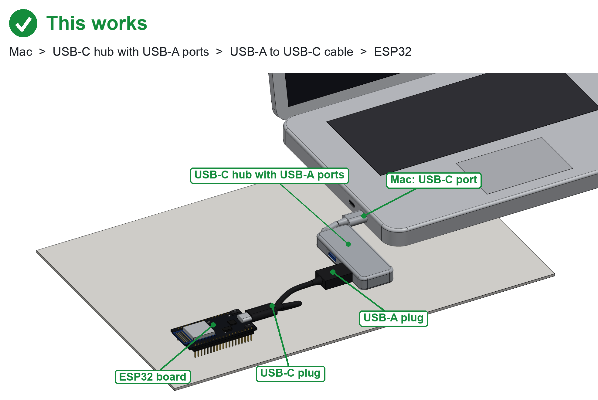

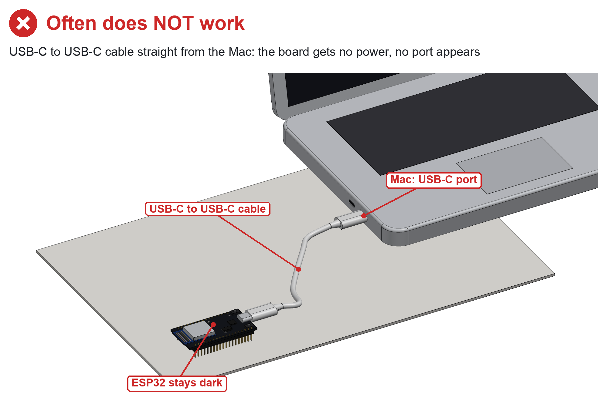

**Use a USB-A to USB-C cable, through a hub or adapter with a USB-A port. Do not use a USB-C to USB-C cable.**

Why: a USB-C port on a Mac only switches its power on when the device at the other end says "I am here", with two
tiny resistors on the device's USB-C socket. Many of these ESP32 boards leave those resistors out. With a USB-C to
USB-C cable the board then gets no power at all: no light, no port, nothing to upload to. A USB-A port always gives
power, so a USB-A to USB-C cable works every time.

The second trap is a **charge-only cable**: it has power wires but no data wires. The board's red light comes on, but
the Mac never sees it (no port appears in [Step 6](#step-6-plug-in-the-board)). If that happens, try another cable:
the one that came with a phone or a power bank usually carries data.

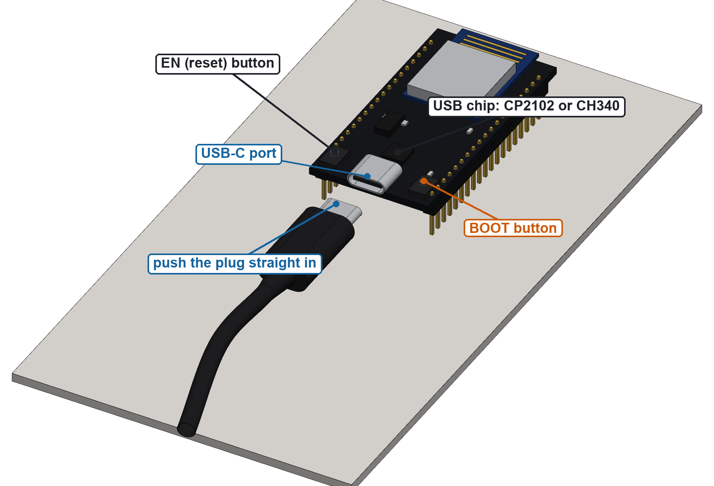

Push the plug straight and fully into the board's port. Note the two small buttons beside the port: you may need
**BOOT** in [Step 7](#step-7-upload-the-firmware). **EN** restarts the board. Each button has its name printed next
to it on the board.

### Step 1: Install VS Code

1. Open **Safari** and go to <https://code.visualstudio.com/download>.
2. Click **Download for Mac** (top right, ringed below).

   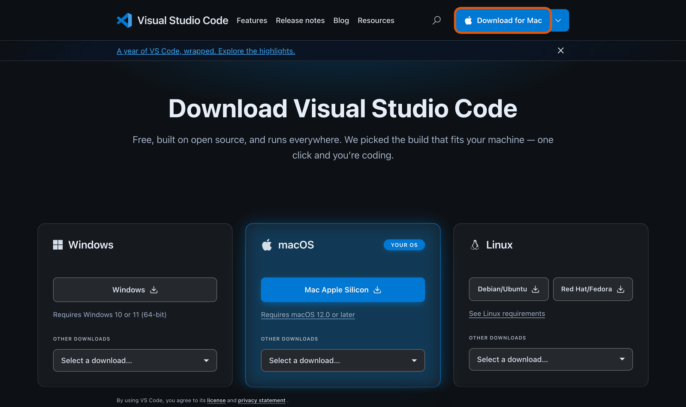

3. When the download finishes, open the **Downloads** folder (Finder, then **Downloads** in the sidebar, or click the
   download arrow in Safari's toolbar). You will see **Visual Studio Code** (an app with a blue icon). If you see a
   `.zip` file instead, double-click it first and the app appears next to it.
4. Drag **Visual Studio Code** onto **Applications** in the Finder sidebar. This installs it.
5. Open **Applications** and double-click **Visual Studio Code**. macOS asks *"Visual Studio Code" is an app downloaded
   from the Internet. Are you sure you want to open it?* Click **Open**.
6. VS Code opens with a **Welcome** page. You can close that tab (the **×** next to *Welcome*).

Tip: to find VS Code again later, press **⌘ Space**, type `code` and press **Return**.

### Step 2: Install PlatformIO

1. In VS Code, click the **Extensions** icon in the left bar (four small squares, one of them tilted), or press
   **⌘ Shift X**.
2. In the search box at the top type **PlatformIO IDE**.
3. Find **PlatformIO IDE** by **PlatformIO**: the orange alien face, millions of downloads and a blue check mark. Click
   its blue **Install** button. Do **not** pick look-alikes (*pioarduino*, *PlatformIO Big Buttons*, ...).

   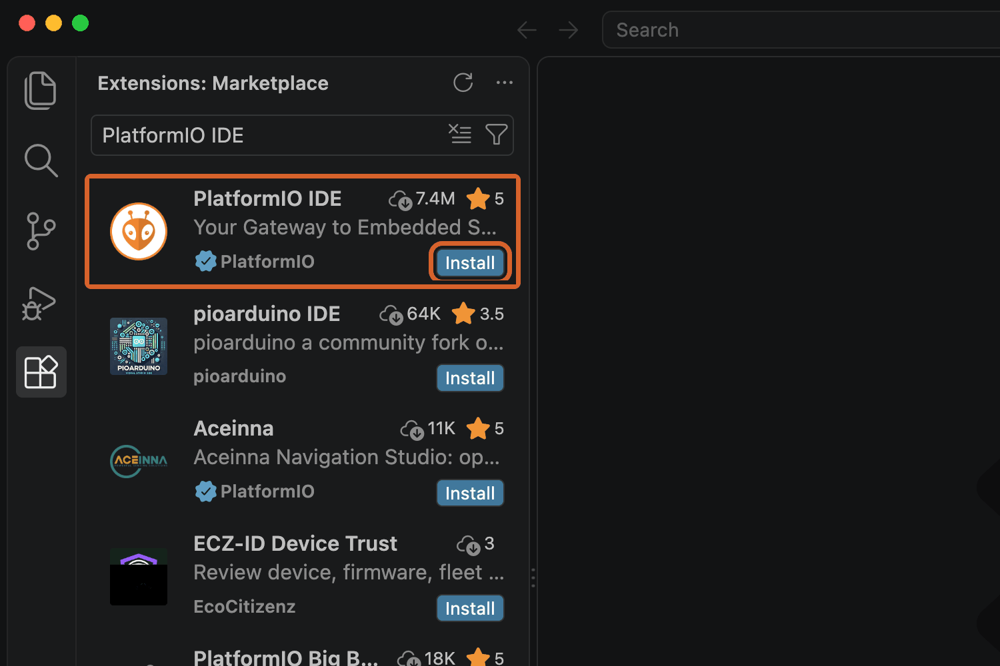

4. VS Code asks **Do you trust the publisher "PlatformIO"?** Click **Trust Publisher & Install**.

   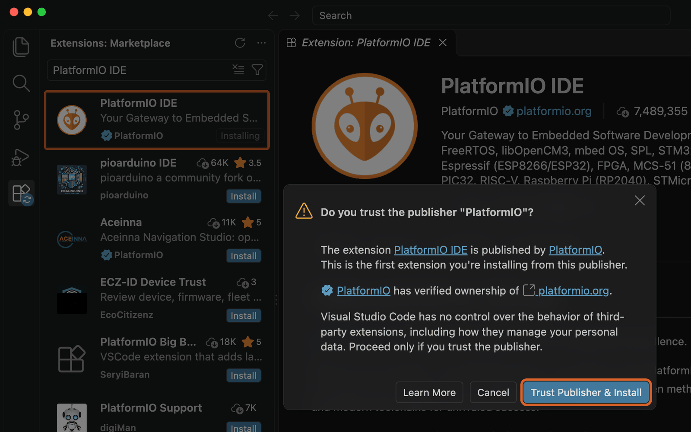

5. Wait. When the install is done, an **alien face** icon appears in the left bar (ringed below). This is PlatformIO.

   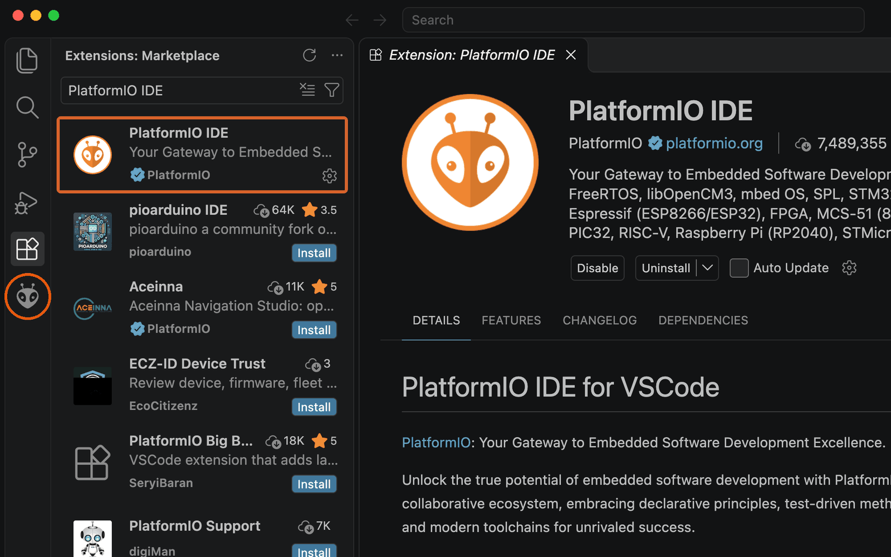

6. **The first time only**, PlatformIO now installs its own tools ("PlatformIO Core"). A small message at the bottom
   right says *Installing PlatformIO Core...*. This takes 5 to 10 minutes; keep the Mac online and VS Code open. When
   it is done it asks you to reload: click **Reload Now** (or quit VS Code with **⌘ Q** and open it again).
7. If macOS shows a window asking to install the **"command line developer tools"**, click **Install**, wait for it to
   finish (10 to 20 minutes), then quit VS Code (**⌘ Q**) and open it again. PlatformIO then carries on by itself.

### Step 3: Download this firmware

1. In Safari go to <https://github.com/hrvy-ngl-893/rurbanise-weather-station-2026>.
2. Click the green **Code** button, then **Download ZIP**. You do not need a GitHub account.

   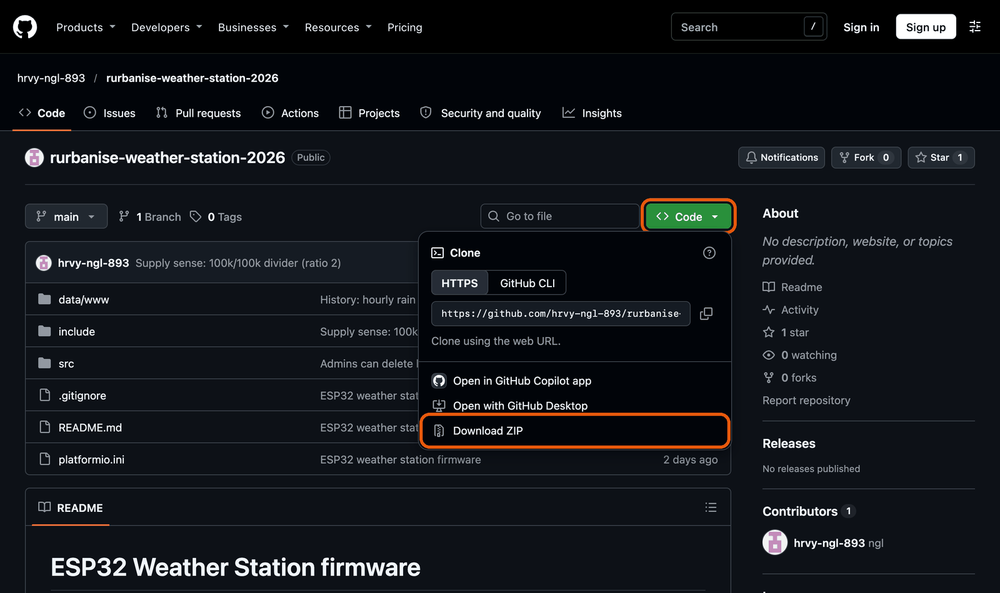

3. In **Downloads** you get a folder called **rurbanise-weather-station-2026-main** (Safari unzips it; if you see a
   `.zip`, double-click it).
4. Move that folder somewhere you will find it again, for example **Documents**. Keep its name.

### Step 4: Open the folder in VS Code

1. In VS Code choose **File > Open Folder...** from the menu bar at the very top of the screen (or press **⌘ O**).
2. Go to **Documents**, click **rurbanise-weather-station-2026-main** once (the folder itself, not a file inside it) and
   click **Open**.
3. VS Code asks **Do you trust the authors of the files in this folder?** Click **Yes, I trust the authors**.
   If you clicked the other button by mistake, the bottom left of the window says **Restricted Mode**: click those
   words, then click **Trust**.
4. The **Explorer** on the left now shows the folders `data`, `include`, `src` and the file `platformio.ini`:

   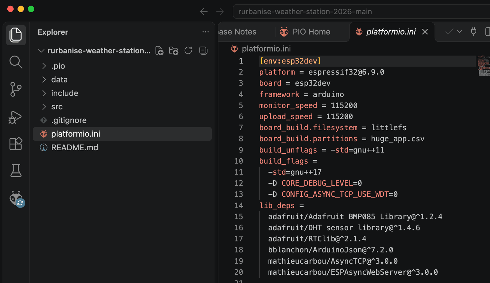

5. **The first time only**, PlatformIO now downloads the ESP32 tools and the libraries this project uses (a few
   hundred MB). The bottom bar shows that it is busy. Wait until it is quiet: about 5 to 15 minutes, depending on
   your internet.

### Step 5: Build (a test, no board needed)

Building turns the code into the file that goes onto the board. Doing it once before plugging anything in shows that
everything is installed correctly.

1. Click the **alien** icon in the left bar. The **PlatformIO** panel opens.
2. Under **Project Tasks**, click **esp32dev**, then **General**. You see **Build**, **Upload**, **Monitor** and more.

   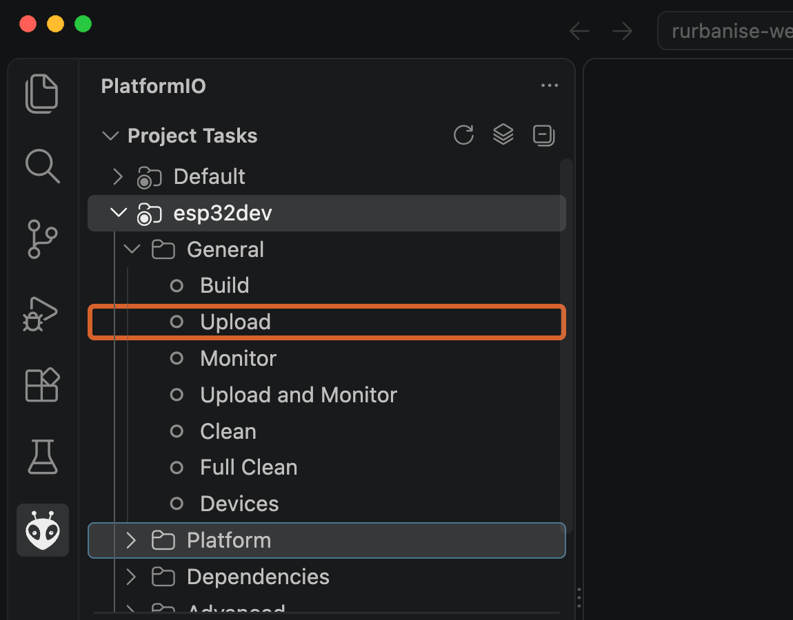

3. Click **Build**. A **terminal** panel opens at the bottom and text scrolls past. The first build takes 2 to 5
   minutes. It is finished when you see a green **SUCCESS** line:

   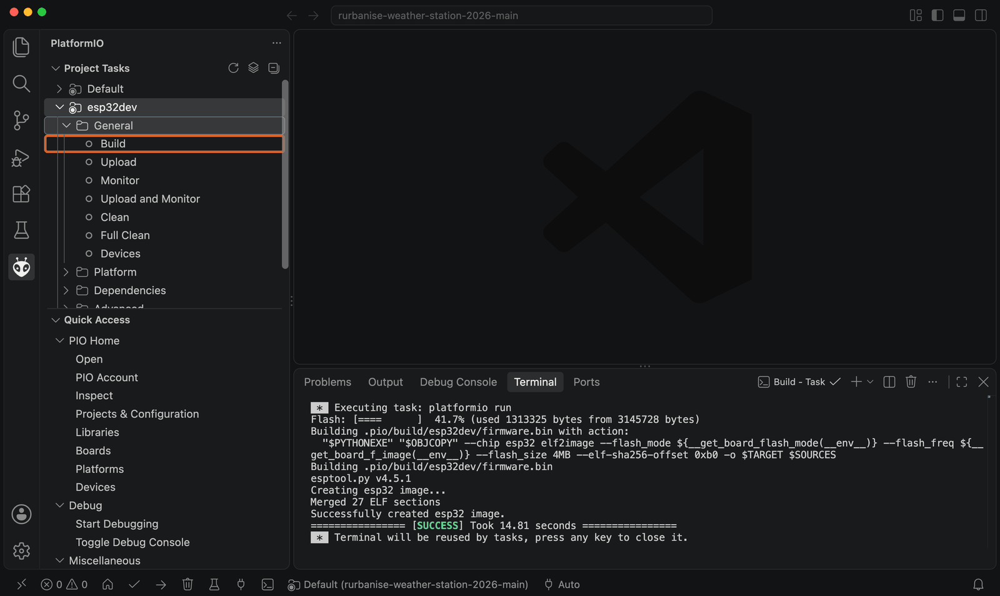

   Red **FAILED** instead? See [Troubleshooting](#part-2-troubleshooting). Yellow *warning* lines are normal.

Shortcut: the same buttons are also in the bar along the bottom of the window, as small icons. Hover the mouse over
one to see its name.

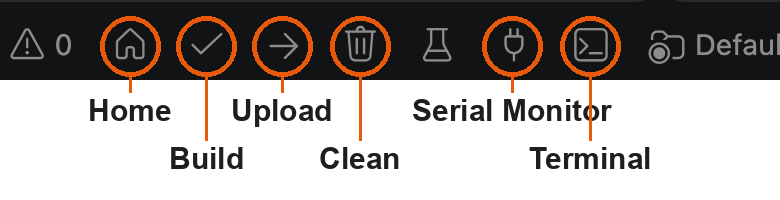

### Step 6: Plug in the board

1. If the board is in the station, **unplug the station's power adapter** from the board's USB-C port. The Mac will
   power the board while you work. The sensors can stay connected.
2. Connect the board as in [the cable pictures](#the-cable-read-this-first): Mac, then the hub or adapter, then the
   USB-A to USB-C cable, then the board.
3. A Mac laptop may ask **Allow accessory to connect?** Click **Allow**.
4. A small **red light** on the board comes on. No light: the board gets no power. Check the cable type and that
   both plugs are pushed in fully.
5. Check that the Mac sees the board: in VS Code choose **Terminal > New Terminal**, type the line below in the
   terminal at the bottom and press **Return**:

   ```sh
   ls /dev/cu.*
   ```

   You should see a line like **`/dev/cu.usbserial-0001`** (or `/dev/cu.usbserial-` / `/dev/cu.wchusbserial` with
   other numbers). That is your board. If you only see lines with *Bluetooth* or *debug-console*, the Mac does not
   see the board: try another cable (it may be charge-only), then see
   [Troubleshooting](#part-2-troubleshooting).

### Step 7: Upload the firmware

1. In the PlatformIO panel (alien icon), under **esp32dev > General**, click **Upload**.
2. PlatformIO builds the code again (quick now) and finds the board by itself. The terminal shows something like:

   ```text
   Auto-detected: /dev/cu.usbserial-0001
   Uploading .pio/build/esp32dev/firmware.bin
   Connecting....
   Chip is ESP32-D0WD-V3 (revision v3.1)
   Writing at 0x00010000... (3 %)
   Writing at 0x0001f8a4... (6 %)
   ...
   Hash of data verified.
   Leaving...
   Hard resetting via RTS pin...
   ======================== [SUCCESS] Took 75.31 seconds ========================
   ```

   This takes 1 to 3 minutes. Do not unplug the board while it says *Writing*.
3. **If it hangs at `Connecting........_____....`**: press and **hold the BOOT button** on the board (see
   [the close-up picture](#the-cable-read-this-first)), and let go when `Writing at ...` appears. If it already gave
   up, click **Upload** again and hold **BOOT** as soon as `Connecting` appears.

### Step 8: Upload the web app

The station's web pages (what you see on a phone) are stored separately from the firmware, so they need their own
upload. **Do this on a new board, and every time the `data` folder changes.**

1. In the PlatformIO panel, under **esp32dev**, click **Platform** to open it.
2. Click **Upload Filesystem Image**.

   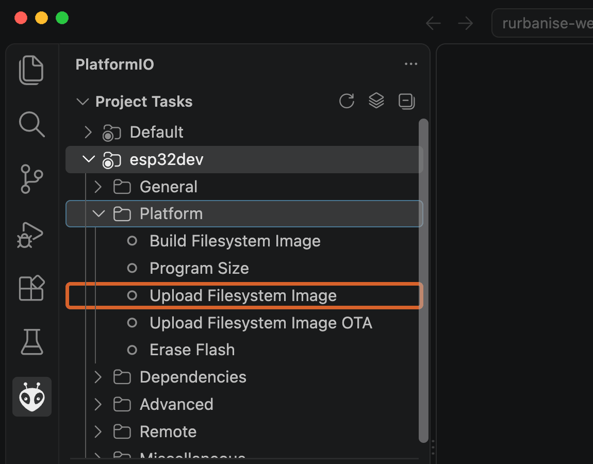

3. Wait for the green **SUCCESS** line, as in Step 7. Hold **BOOT** if it hangs at `Connecting`.

Note: this replaces everything in the board's file area. The station's settings (passwords, Wi-Fi, location, north)
and the SD card data are kept, but a remote-upload **certificate** is stored in the file area: if the station uploads
to a data server, paste the certificate again afterwards (web app, **Admin**, box 5, **Save certificate**).

### Step 9: Check that it works

1. In the PlatformIO panel, under **esp32dev > General**, click **Monitor**. The terminal shows what the board prints.
2. Press the **EN** button on the board once (it restarts). You should see lines like:

   ```text
   boot: sensors
   boot: wifi/web
   boot: rtc
   boot: sd
   boot: done
   ```

   Lines such as `DS3231 not found` or a BMP180 message mean a sensor or the clock is not connected; that is
   expected on a bare board on your desk.
3. Close the monitor before uploading again: click in the terminal and press **Ctrl C**, or click the bin icon at the
   top right of the terminal panel. (An open monitor keeps the port busy and the next upload fails.)
4. On a phone: press the station's round button (or **EN** on a bare board), join the Wi-Fi **WeatherStation**
   (password `weather1234` on a new station) and open <http://weatherstation.local> (or <http://192.168.4.1>). The
   **Live** page should appear.
5. Unplug the cable from the board. On a station, plug its power adapter back in.

### Updating later

1. Download the newest ZIP as in [Step 3](#step-3-download-this-firmware) and open that folder in VS Code
   ([Step 4](#step-4-open-the-folder-in-vs-code)).
2. Plug in the board ([Step 6](#step-6-plug-in-the-board)).
3. Click **Upload** ([Step 7](#step-7-upload-the-firmware)), then **Upload Filesystem Image**
   ([Step 8](#step-8-upload-the-web-app)).

Uploading does not erase the station's settings (Wi-Fi, passwords, location, north offset) or the readings on the SD
card. Only a saved remote-upload certificate needs pasting again after Step 8.

---

## Part 2: Troubleshooting

| What you see | What to do |
|---|---|
| No red light on the board | No power. Use a **USB-A to USB-C** cable through a hub or adapter, not USB-C to USB-C ([why](#the-cable-read-this-first)). Push both plugs in fully. Try another port on the hub. |
| Red light, but `ls /dev/cu.*` shows no `usbserial` line | The cable is probably charge-only: try another one. Still nothing with a cable you know carries data: install the driver for the board's USB chip (the small chip near the USB port): [CP210x driver](https://www.silabs.com/developer-tools/usb-to-uart-bridge-vcp-drivers) or [CH340 driver](https://www.wch-ic.com/downloads/CH34XSER_MAC_ZIP.html), restart the Mac, try again. |
| Upload hangs at `Connecting........_____` and fails | Hold **BOOT** while it says `Connecting`, let go at `Writing at` ([Step 7](#step-7-upload-the-firmware)). |
| `could not open port` or `port is busy` | The serial monitor or another app is using the board. Close the monitor (bin icon in the terminal panel) and any other serial app, then Upload again. |
| `A fatal error occurred: ... No serial data received` | Bad cable or loose plug. Re-plug, use a different hub port, hold BOOT during `Connecting`. |
| PlatformIO tasks list is empty, or no alien icon | PlatformIO is still installing (Step 2.6) or VS Code needs a reload: quit VS Code with **⌘ Q** and open it again. Make sure you opened the folder that contains `platformio.ini` (Step 4). |
| Build ends in red `FAILED` on the first try | Usually a download that was cut off. Check the internet, then click **Build** again. Still failing: in the PlatformIO panel, under **General**, click **Clean**, then **Build**. |
| Phone shows *Page not found. Upload the LittleFS filesystem image.* | Do [Step 8](#step-8-upload-the-web-app). |
| Two boards plugged in, upload goes to the wrong one | Unplug the other board, or see the command line options below. |

---

## Part 3: Command line (for experienced users)

```sh
pio run                  # build
pio run -t upload        # firmware
pio run -t uploadfs      # web app (data/www, LittleFS)
pio device monitor       # serial log, 115200 baud
```

With more than one board plugged in, add `--upload-port /dev/cu.usbserial-XXXX` (macOS) or `--upload-port COM5`
(Windows). The same buttons are in the PlatformIO panel on Windows and Linux; only the driver and port names differ.

## What is in this repository

| Path | Contents |
|---|---|
| `src/` | Firmware: sensors, logging, web server, upload |
| `include/config.h` | Pin map and constants |
| `data/www/` | Web app, served from LittleFS |
| `platformio.ini` | Board, libraries and build settings |
| `docs/images/` | Pictures for this guide (VS Code screenshots taken on macOS; cable pictures rendered from simple 3D models) |
